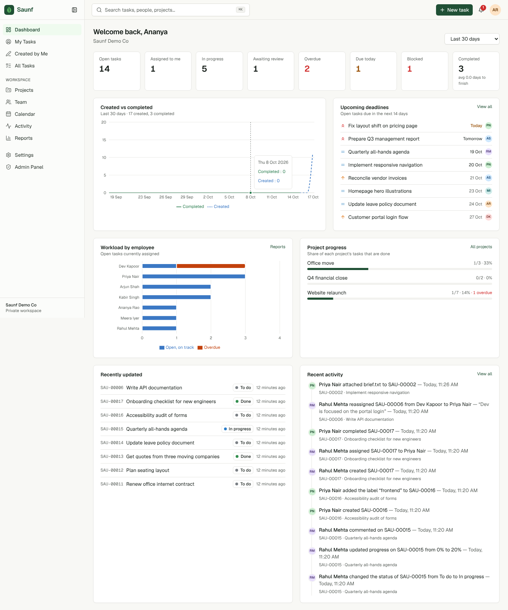
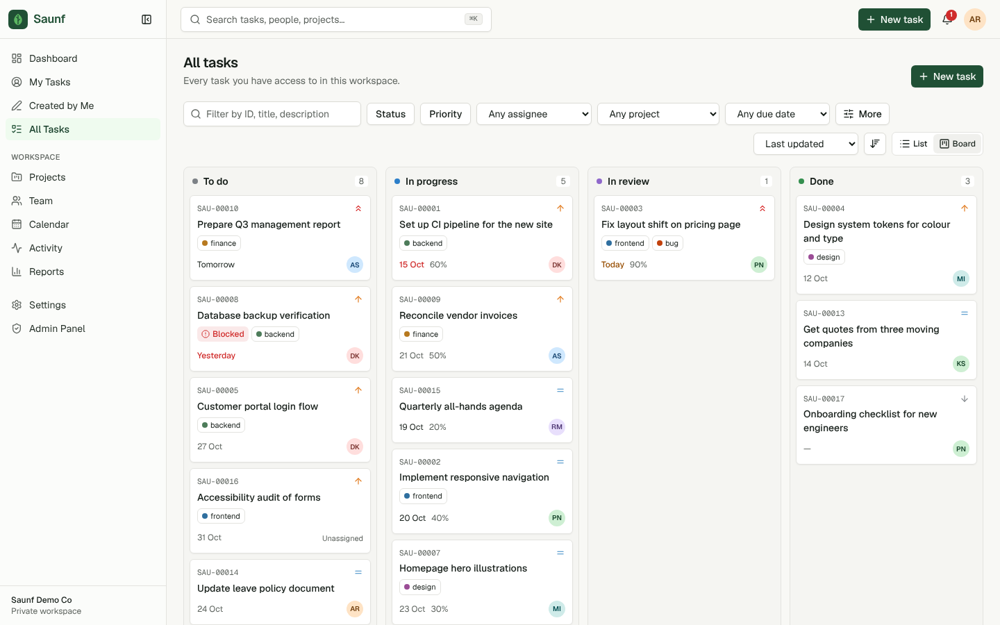
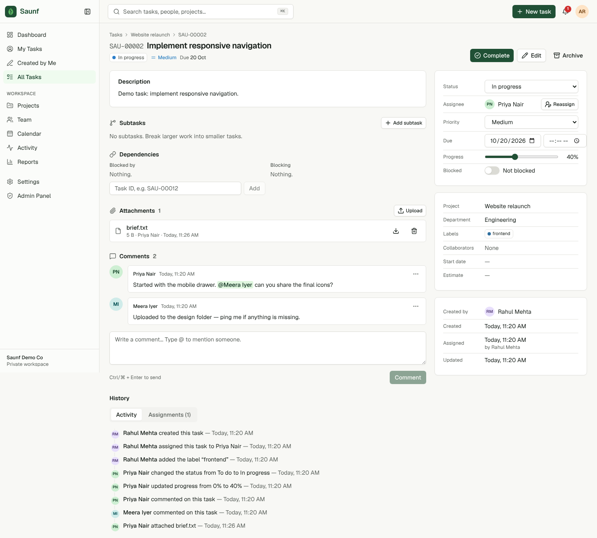
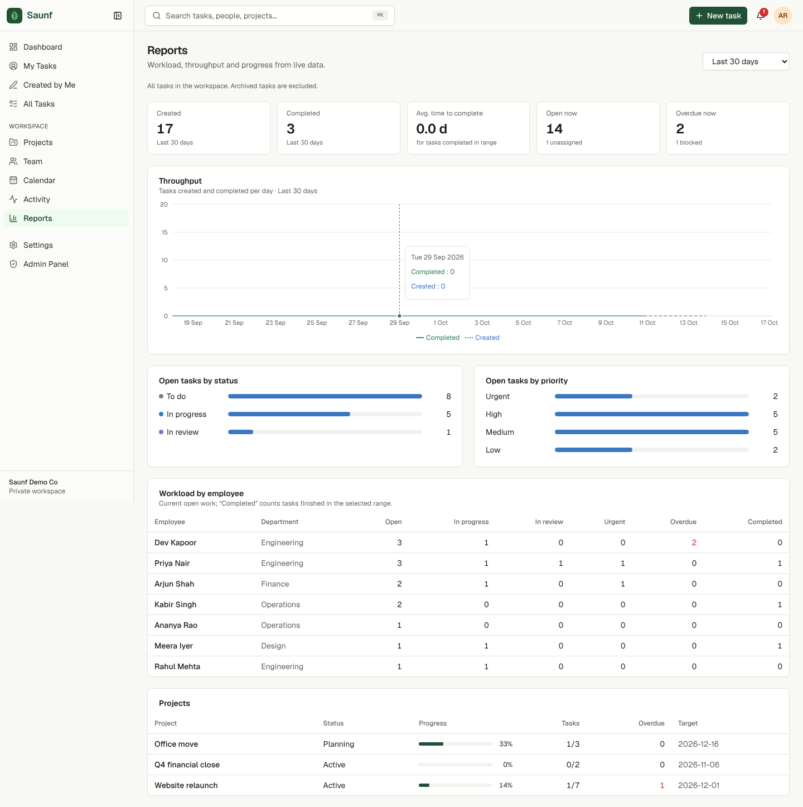

# Saunf

Saunf is a private task-management workspace for teams inside one organisation. It covers the parts of Jira most teams actually use, with less to learn: tasks with owners and deadlines, boards, projects, comments, files, notifications and a full audit trail.

- **Tasks.** Each task gets a readable ID (`SAU-00042`). Tasks have an assignee, collaborators, priority, status, progress, start and due dates, labels, subtasks, dependencies and a separate _blocked_ flag.
- **Views.** List (sortable, paginated, bulk actions), Kanban board (drag and drop), Calendar (month/week), My Tasks and Created by Me. Filters live in the URL, so you can bookmark or share a filtered view.
- **Collaboration.** Comments with @mentions, file attachments in private storage, and in-app notifications. Due-soon and overdue reminders run on a schedule.
- **History.** An append-only activity log that reads like a timeline ("Rahul changed the status from To do to In progress — 11:05 AM"), plus a complete assignment history.
- **Organisation.** Projects (public or private), departments, employee directory, dashboard, reports and an admin panel.
- **Accounts.** People sign up at `/signup` and go straight to their dashboard. The first person to sign up on a new installation becomes the admin; everyone after joins as an employee. Admins can optionally limit sign-up to company email domains, require approval, or invite people instead.
- **Security.** Admin, manager and employee roles and the workspace policies are enforced by PostgreSQL Row Level Security and triggers, not by hiding buttons.

See [`docs/ARCHITECTURE.md`](docs/ARCHITECTURE.md) for the design, [`docs/SECURITY.md`](docs/SECURITY.md) for the permission matrix, [`docs/DEPLOYMENT.md`](docs/DEPLOYMENT.md) for production setup and backups, and [`CHECKLIST.md`](CHECKLIST.md) for status and known limitations.

## Screenshots

| Dashboard                                           | Board                                          |
| --------------------------------------------------- | ---------------------------------------------- |
|      |  |
| **Task detail**                                     | **Reports**                                    |
|  |     |

More in [`docs/screenshots/`](docs/screenshots/) (captured with the local demo seed).

## Stack

Next.js 16.4 (App Router, Cache Components, `proxy.ts`) · React 19.3 · TypeScript (strict) · Tailwind CSS 4 · shadcn/ui-style components on Radix · Lucide · Supabase (Postgres 17, Auth, Storage, `pg_cron`) via `@supabase/ssr` · Zod 4 · React Hook Form · date-fns 4 · dnd-kit · Recharts 3 · Vitest · Playwright.

## Local development

### Prerequisites

- Node.js 20.9+ (developed on 22)
- Docker, for the local Supabase stack

### 1. Install and start Supabase

```bash
npm ci
npm run db:start          # starts Postgres, Auth, Storage, Mailpit… and applies migrations
npx supabase status       # prints the local URL and keys
```

### 2. Configure environment

```bash
cp .env.example .env.local
```

Fill in `.env.local` with the values from `npx supabase status`:

| Variable                                                             | Required  | Description                                                                                       |
| -------------------------------------------------------------------- | --------- | ------------------------------------------------------------------------------------------------- |
| `NEXT_PUBLIC_SUPABASE_URL`                                           | yes       | API URL (local: `http://127.0.0.1:54321`)                                                         |
| `NEXT_PUBLIC_SUPABASE_PUBLISHABLE_KEY`                               | yes       | Publishable/anon key. Safe for the browser.                                                       |
| `SUPABASE_SECRET_KEY`                                                | yes       | Secret/service-role key. **Server only.** Used solely for Auth admin calls (invite, create, ban). |
| `NEXT_PUBLIC_SITE_URL`                                               | yes       | Base URL of the app, used in invite and reset links                                               |
| `CRON_SECRET`                                                        | for email | Bearer secret for `/api/cron/email-notifications`                                                 |
| `RESEND_API_KEY`, `EMAIL_FROM`                                       | optional  | Turns on notification emails. Without them, in-app notifications still work.                      |
| `NEXT_PUBLIC_VAPID_PUBLIC_KEY`, `VAPID_PRIVATE_KEY`, `VAPID_SUBJECT` | optional  | Free browser/phone push notifications. Generate keys with `npx web-push generate-vapid-keys`.     |

### 3. Create the workspace and first admin

The simplest way is to open http://localhost:3000/signup and sign up. On an empty database, the first account creates the workspace and becomes its admin. Rename the workspace later in **Admin → Workspace settings**.

You can also create it from the command line, choosing the name, task prefix and timezone:

```bash
npm run bootstrap -- --workspace "Acme Ltd" --slug acme --prefix SAU \
  --email you@acme.com --name "Your Name" --password 'a-strong-password' --timezone Asia/Kolkata
```

Leave out `--password` to send an invitation email instead. Locally, those emails land in Mailpit at http://127.0.0.1:54324.

To fill the workspace with demo people, projects and tasks for local development only, run:

```bash
npm run seed:demo         # demo users share the password Demo-pass-123
```

### 4. Run the app

```bash
npm run dev               # http://localhost:3000
```

## Database migrations

All schema, RLS policies, triggers, RPCs, storage policies and the cron schedule are version-controlled in `supabase/migrations/`.

```bash
npx supabase migration new <name>   # create a migration
npm run db:reset                    # rebuild the local DB from migrations (destroys local data)
npm run db:types                    # regenerate src/lib/database.types.ts after schema changes
npx supabase link --project-ref <ref> && npm run db:push   # apply to a hosted project
```

| Migration                     | Contents                                                                                            |
| ----------------------------- | --------------------------------------------------------------------------------------------------- |
| `…100000_schema.sql`          | Enums, tables, constraints, indexes                                                                 |
| `…100100_permissions_rls.sql` | Permission helpers (schema `private`), grants, RLS on every table                                   |
| `…100200_triggers.sql`        | Server-derived fields, field-level guards, audit log, assignment history, notifications, auth hooks |
| `…100300_rpc.sql`             | `create_task`, `update_task`, `bulk_update_tasks`, reporting functions, scheduled jobs              |
| `…100400_storage_cron.sql`    | Private `task-attachments` bucket and storage RLS; `pg_cron` job every 15 minutes                   |

## Testing

```bash
npm run lint
npm run typecheck
npm run format:check
npm run test:unit            # pure logic: filters, dates/timezones, permissions mirror, validation, activity text
npm run test:integration     # RLS + workflows against the local Supabase stack (real JWTs, Storage, triggers)
npm run build && npm run test:e2e   # Playwright against the production build + local Supabase + Mailpit
```

- Integration tests create isolated workspaces and users, then clean up after themselves. They refuse to run against a non-local Supabase URL.
- To use an already-installed Chromium for end-to-end tests instead of `npx playwright install`, set `PLAYWRIGHT_CHROMIUM_PATH=/path/to/chromium`.
- The test suites cover login and logout, self sign-up (domain rules and approval), protected routes, invite and password-reset emails, role permissions, workspace isolation, task creation (including concurrent ID generation), assignment policy, reassignment history, status changes, completion and reopening, deadline and progress validation, archiving and restoring, the activity timeline and its append-only guarantees, comment permissions, @mentions, attachment access, notification visibility, the reminder scheduler, inactive users, the Kanban drag, and the mobile layout.

## Deployment (summary)

1. Create a Supabase project. Enable the `pg_cron` extension, then run `npm run db:push`.
2. In Supabase Auth settings: allow sign-ups (needed for `/signup`), set the Site URL and redirect URLs to your app, set the minimum password length to 8, and configure SMTP. Once SMTP is set up you can also paste the templates from `supabase/templates/`. Both custom and default templates work.
3. Deploy to Vercel with the environment variables above. `vercel.json` schedules the email cron. Note that the Hobby plan only allows daily crons.
4. Open `/signup` on your deployment and create your account. The first sign-up becomes the admin.

Full steps, backup and restore guidance, and the retention notes are in [`docs/DEPLOYMENT.md`](docs/DEPLOYMENT.md).

## Project structure

```
src/app/(auth)       login, password reset, invitation acceptance, no-access
src/app/(app)        dashboard, task views, task detail, projects, team, calendar,
                     activity, reports, notifications, search, settings, admin
src/app/auth/confirm email-link verification (token_hash / PKCE)
src/app/api/cron     notification email sender
src/actions          server actions (tasks, projects, admin, notifications, search, profile)
src/components       ui primitives, layout shell, feature components
src/lib              Supabase clients, data-access layer, queries, validation, dates, permissions mirror
supabase/            config, migrations, auth email templates
tests/               unit, integration (RLS), e2e (Playwright)
scripts/             bootstrap (first admin), seed-demo (local only)
```
